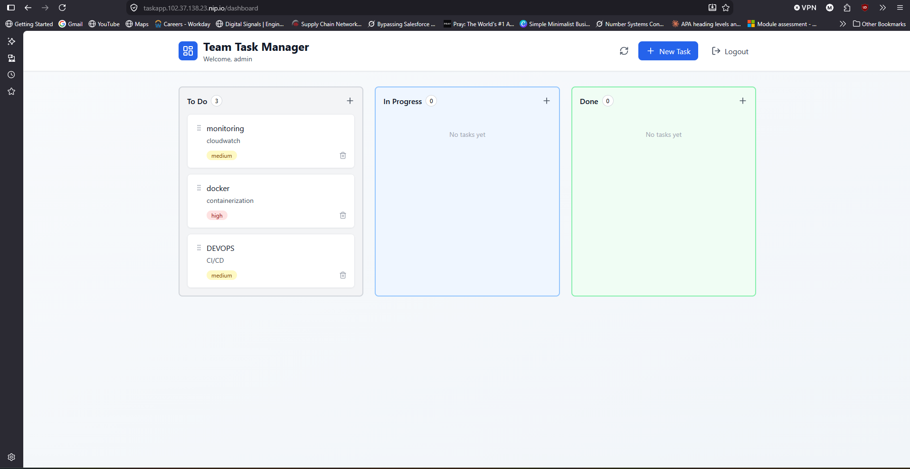

# Phoenix Capstone — Cloud-Native TaskApp on K3s

[](https://azure.microsoft.com/)
[](https://www.terraform.io/)
[](https://www.ansible.com/)
[](https://k3s.io/)
[](https://argo-cd.readthedocs.io/)
[](./.github/workflows/ci.yml)

Production-style DevOps portfolio project for deploying TaskApp to a multi-node K3s cluster with Terraform, Ansible, Kubernetes manifests, and GitOps practices.

## Live Demo

- Declared URL: **https://taskapp.102.37.138.23.nip.io**
- Verification status from this environment: **not currently verifiable** (DNS resolution failed during validation)



## Project Overview & Engineering Objectives

This repository demonstrates a cloud-native deployment flow:

1. Provision Azure infrastructure using Terraform.
2. Configure a K3s cluster using Ansible roles.
3. Deploy TaskApp workloads with Kubernetes manifests.
4. Operate with Git-based workflows, CI checks, and captured evidence.

## Architecture (Verified from Repository + Evidence)

```mermaid
flowchart LR
  Dev[Developer] --> GitHub[GitHub Repository]
  GitHub --> CI[GitHub Actions CI\n(.github/workflows/ci.yml)]
  GitHub --> TF[Terraform\ninfra/terraform]
  GitHub --> Ansible[Ansible\ninfra/ansible]
  GitHub --> K8sManifests[Kubernetes Manifests\nmanifests/]

  TF --> Azure[Azure VMs]
  Ansible --> K3s[K3s Cluster\n1 control-plane + 2 workers]
  K8sManifests --> K3s

  User[User Browser] --> Ingress[Ingress + TLS\n(evidence only)]
  Ingress --> FrontendSvc[frontend Service]
  Ingress --> BackendSvc[backend Service]
  FrontendSvc --> FrontendPods[frontend Deployment\n2 replicas]
  BackendSvc --> BackendPods[backend Deployment\n2 replicas + HPA]
  BackendPods --> PostgresSvc[postgres Service]
  PostgresSvc --> Postgres[postgres StatefulSet + PVC]

  GitOps[Argo CD Sync/Health\n(evidence only)] --> K3s
```

> `Ingress/TLS` and `Argo CD` are evidenced in `docs/EVIDENCE/`, but corresponding Kubernetes manifests are not currently committed under `manifests/` or `gitops/`.

## Technology Stack

| Layer | Technology | Role in this repository |
|---|---|---|
| Cloud | Azure | Target infrastructure provider |
| Infrastructure as Code | Terraform | Provisions worker VMs and networking resources |
| Configuration Management | Ansible | Installs K3s server/agents and base hardening |
| Orchestration | K3s / Kubernetes | Runs frontend, backend, and PostgreSQL workloads |
| Application Delivery | Kubernetes manifests | Defines Deployments, StatefulSet, Services, HPA, PDB, NetworkPolicy, migration Job |
| GitOps | Argo CD | Demonstrated by evidence (`Synced/Healthy`) |
| CI | GitHub Actions | Backend syntax check + frontend build |

## Key Implementation Details (Verified)

- **Multi-node cluster evidence:** 1 control-plane + 2 worker nodes (`docs/EVIDENCE/nodes-ready.txt`).
- **Workload distribution evidence:** frontend/backend replicas scheduled across different nodes (`docs/EVIDENCE/pods-spread.txt`).
- **Persistence:** PostgreSQL StatefulSet with PVC (`manifests/postgres/deployment.yaml`, `docs/EVIDENCE/storage-services.txt`).
- **Reliability controls:** rolling updates (`maxUnavailable: 0`), HPA, PDBs, health probes.
- **Security controls:** namespace default-deny NetworkPolicy model and seccomp runtime default on app Deployments.
- **Migration workflow:** dedicated migration Job (`manifests/migration-job.yaml`, `docs/EVIDENCE/migration.txt`).

## Security & Reliability Notes

Implemented in committed manifests:

- Backend resource requests/limits.
- Pod anti-affinity for backend replicas.
- PDB for frontend and backend.
- Default-deny + allow-list NetworkPolicies.
- HPA for backend autoscaling.

Gaps to be aware of in tracked manifests:

- No committed Ingress or TLS issuer manifest in `manifests/`.
- No committed ConfigMap/Secret manifests for `phoenix-config` and `phoenix-secret` references.
- PostgreSQL image uses a major tag (`postgres:16`) rather than an immutable digest.

## CI/CD and GitOps Workflow

- **CI:** `.github/workflows/ci.yml` runs backend compile checks and frontend build on push/PR to `main`.
- **GitOps:** `docs/EVIDENCE/argocd.txt` shows `phoenix` app in `Synced` and `Healthy` state.
- **Current repository limitation:** `gitops/` currently contains documentation only (no committed Argo CD `Application` manifest).

## Deployment Evidence

Primary evidence index: [`docs/EVIDENCE/README.md`](docs/EVIDENCE/README.md)

- Node readiness: [`docs/EVIDENCE/nodes-ready.txt`](docs/EVIDENCE/nodes-ready.txt)
- Pod spread across nodes: [`docs/EVIDENCE/pods-spread.txt`](docs/EVIDENCE/pods-spread.txt)
- Storage/services/ingress snapshot: [`docs/EVIDENCE/storage-services.txt`](docs/EVIDENCE/storage-services.txt)
- HPA/PDB/NetworkPolicy: [`docs/EVIDENCE/resilience-security.txt`](docs/EVIDENCE/resilience-security.txt)
- Migration completion: [`docs/EVIDENCE/migration.txt`](docs/EVIDENCE/migration.txt)
- Argo CD health/sync: [`docs/EVIDENCE/argocd.txt`](docs/EVIDENCE/argocd.txt)
- Screenshots: [`docs/EVIDENCE/`](docs/EVIDENCE/)

## Repository Structure

```text
capstone-phoenix/
├── README.md
├── STRUCTURE.md
├── infra/
│   ├── terraform/
│   └── ansible/
├── manifests/
├── gitops/
└── docs/
    ├── ARCHITECTURE.md
    ├── RUNBOOK.md
    ├── COST.md
    └── EVIDENCE/
```

## Prerequisites & Setup

For full environment bootstrap and operations, follow:

- [`docs/RUNBOOK.md`](docs/RUNBOOK.md)

Minimum toolchain expected:

- Terraform
- Ansible
- kubectl
- Access to Azure subscription and Linux VMs

## Deep-Dive Documentation

- Architecture: [`docs/ARCHITECTURE.md`](docs/ARCHITECTURE.md)
- Runbook: [`docs/RUNBOOK.md`](docs/RUNBOOK.md)
- Cost analysis: [`docs/COST.md`](docs/COST.md)
- Evidence pack: [`docs/EVIDENCE/README.md`](docs/EVIDENCE/README.md)

## Challenges, Trade-offs, Lessons Learned

- Moving from single-node assumptions to multi-node scheduling requires explicit resilience controls (HPA, PDB, anti-affinity, NetworkPolicy).
- GitOps improves drift control, but reproducibility is reduced when Argo CD manifests are not committed.
- Portfolio credibility depends on evidence-backed claims; captured outputs are valuable but should align tightly with tracked manifests.

## Known Limitations & Future Improvements

1. Commit missing GitOps manifests (`Application`, sync policy) to `gitops/`.
2. Commit Ingress/TLS manifests (or document exact external source with version pinning).
3. Add reproducible ConfigMap/Secret management pattern (e.g., External Secrets / Sealed Secrets).
4. Pin all runtime images immutably (including PostgreSQL).
5. Replace hardcoded Terraform output values with resource-derived outputs for fully reproducible infra state.
